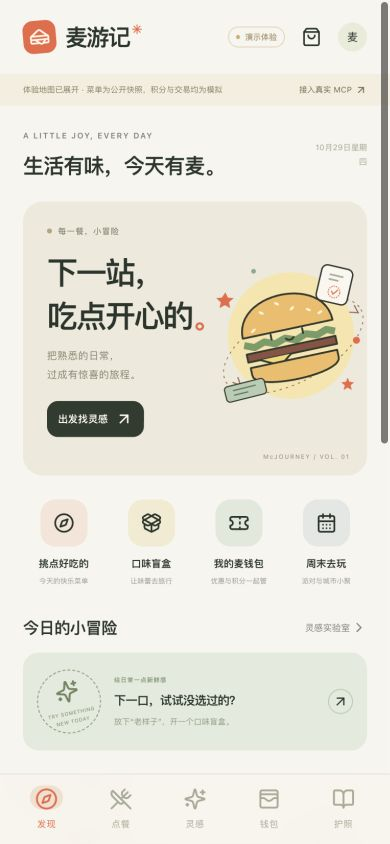
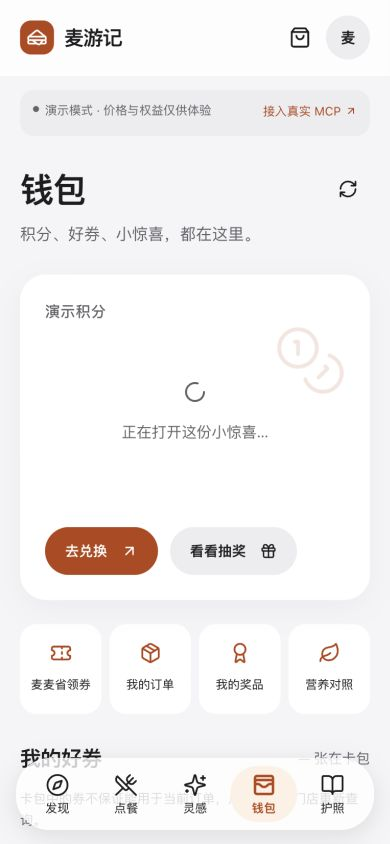
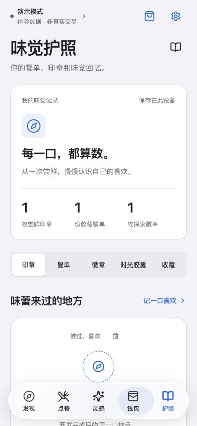
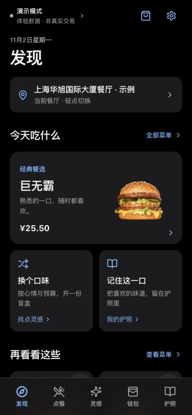

<div align="center">
  
  <h1>麦游记 · McJOURNEY</h1>
  <p><strong>每一餐，都是一场小冒险。</strong></p>
  <p>一款以手机为中心的麦当劳 MCP 趣味生活应用。<br/>认真点餐，也收集日常的小快乐。</p>
</div>

## 打开之后，可以玩什么？

麦游记把官方 MCP 能力变成五个日常入口：

| 入口     | 可以做的事                                                                                                                                                   |
| -------- | ------------------------------------------------------------------------------------------------------------------------------------------------------------ |
| **发现** | Apple 风格内容首页、当前餐厅、今日餐选、味觉记录入口、活动日历、周末主题活动                                                                                 |
| **点餐** | 城市 / 关键词 / 收藏门店搜索、到店自取、得来速、外送、企业团餐、预约时段、餐品搜索与收藏、套餐换配、去冰去酱等特调、购物袋、门店券、官方核价、下单与自主支付 |
| **灵感** | 按心情与菜单参考预算开启口味盲盒、随心转盘、名称关键词排除；先发现，再由你选配                                                                               |
| **钱包** | 积分与到期提醒、卡包分页、麦麦省一键领券、积分商城、规格选择与兑换、积分抽奖及奖品、点餐与商城订单、取消订单、满意度关联奖券、营养对照                       |
| **护照** | 尝鲜印章、评分与心情、餐单收藏与重新核价、探索徽章、时光胶囊、收藏夹、PNG 分享卡与个人手账导出                                                               |

还可以一步步探索 **活动 → 规格 → 包场 / 拼团 → 城市 → 门店 → 日期 → 场次 → 人数 → 确认预约**。每一步都由你选择。

项目没有大模型 API 依赖。玩法和计算在本地完成，真实业务数据来自麦当劳 MCP。不会用生成式文案编造价格、热量、奖品或下单结果。

## 界面预览

<p align="center">
  
  
  
</p>

截图使用演示模式，不包含真实账户信息。界面已按 [Apple Design Skill](https://github.com/dickwu/apple-design-skill) 重做，支持系统深色模式；设计依据与对比度记录见 [改版说明](docs/APPLE_REDESIGN.md)。



### 活动日历

日历已用真实 MCP 数据复核，提供月历 / 周视图、按天筛选、全月分组、可展开详情与完整海报。以下截图只包含公开活动；[设计与验证记录](docs/CALENDAR_DESIGN.md)。


## 先运行起来

需要 **Node.js 22.12+（推荐 24）**、npm。复用 Codex 配置的便捷脚本另外需要 Python 3.11+。

```bash
npm ci
npm run dev
```

浏览器打开 **http://127.0.0.1:4317**。未设置凭据时进入演示模式，可以体验完整流程，不会产生真实权益变更或支付。

### 使用真实麦当劳账户

方式一：自行申请 [麦当劳 MCP Token](https://open.mcd.cn/mcp)，在项目根目录创建本地 `.env`：

```dotenv
MCD_MCP_TOKEN=你的本机凭据
```

重启 `npm run dev`。Token 仅由服务端读取；`.env` 已被 Git 忽略。不要提交真实 Token。

方式二：如果本机 Codex 已配置 `https://mcp.mcd.cn`：

```bash
npm run dev:codex
```

此脚本只读取本机 MCP 配置中的对应凭据，在内存中交给子进程；不会打印或另存凭据。找不到配置时明确报错。它不会修改 Codex 配置。

真实模式需要先选门店；不会把示例门店当作你的位置。网络、鉴权或业务错误会明确显示，**不会自动切换成演示结果**。

### 生产构建

```bash
npm run check          # 自动化测试 + TypeScript 检查 + 生产构建
npm start              # 服务 dist/，默认本机 4317 端口
# 或复用 Codex MCP：
npm run start:codex
```

同一时刻仅在同一端口运行一个实例。修改服务端 `.env` 或 `server/` 代码后需重启服务。

## 手机上使用

前端适配 360px 起的手机视口、平板和桌面，底部导航支持安全区域；支持通过浏览器添加到主屏幕。

本机 `localhost` 链接不能直接在另一台手机访问。自行配置局域网体验时，在 `.env` 中设置：

```dotenv
HOST=0.0.0.0
APP_ACCESS_KEY=请设置至少16位的独立强口令
```

重启后在同一网络的手机访问 `http://电脑局域网IP:4317`，输入应用访问口令。**只适合受信任的私人网络**；HTTP 不加密传输。长期使用、安装 PWA 或跨网络访问应配置 HTTPS 反向代理。仓库不包含公网托管和多用户账户系统，勿直接暴露到公网。

应用的 MCP Token 对应同一个账户；知道访问口令的人可操作该账户。默认仅监听 `127.0.0.1`。主屏幕安装需要 HTTPS 或本机 localhost。Service Worker 仅缓存静态资源，账户、订单、核价及 API 响应不进入离线缓存。

## 数据与交易的边界

- **演示菜单**：2026-10-29 通过已连接 MCP 实测的上海示例门店公开快照，112 款餐品、160 条营养记录、6 份完整餐品详情。其余演示详情为简化结构，会单独提示。
- **演示账户**：积分、优惠券、商城、活动及交易是虚构体验数据；每个浏览器会话独立，服务端重启后清空。演示优惠券不用于模拟虚假折扣。
- **真实价格**：菜单展示价仅供参考；套餐换配、特调、优惠与费用经 `calculate-price` 核验。金额按接口单位处理：核价金额为整数分，订单详情中的价格为元。
- **账户变更**：一律先生成短时预览，再由用户确认执行一次。提交前再次核价或重验消耗；变化时要求重新确认。超时和失败不会自动重试交易。
- **抽奖**：以服务端 `drawDecision.resourceEligible` 与 `nextConsumption` 为准；优先次数及后续积分兜底会完整展示。不计算中奖概率、不连抽。
- **支付**：仅打开官方返回的 HTTPS 支付链接，由用户自行完成。项目没有自动支付功能。
- **营养**：仅精确匹配官方标准餐品。缺失数据保持未知，不把名称过滤当作过敏原筛查，不推算特调或未知规格的营养值。
- **个人记录**：收藏、印章、餐单和胶囊保存在本浏览器，可导出和清空。印章为用户自记，徽章是趣味反馈，不代表官方消费、任务完成或奖励资格。
- **收藏餐单**：保留餐品与数量；重新读取原门店、原取餐方式下的当前默认搭配。旧特调、优惠券和价格不沿用，重建会替换当前餐袋。

## 技术与验证

```text
手机 / 桌面 React + TypeScript + PWA
            │ 同源 HTTP / HttpOnly 会话 / 确认预览
            ▼
      Node.js + Express
            │ 官方 MCP SDK / Streamable HTTP
            ▼
       https://mcp.mcd.cn
```

服务端动态发现官方工具与输入 Schema，以允许列表暴露 35 项能力；兼容工具名的连接符差异。写操作不能通过普通工具路由绕过确认。JSON Schema 参数校验、跨来源请求检查、会话绑定、60 秒一次性预览、串行账户变更均有自动化验证。

- [MCP 接入与能力映射](MCP_INTEGRATION.md)
- [真实只读联调记录](docs/live-verification.json)：应用 HTTP API → 官方 SDK → 官方服务；不记录私人账户内容
- [验证说明](docs/VERIFICATION.md)
- [设计说明](docs/DESIGN.md)

```bash
npm test              # 业务规则与服务端集成测试
npm run build         # 类型检查与正式构建
npm run format        # 格式化源码
npm run icons         # 从原创 SVG 重新生成 PWA 图标
```

## 项目目录

```text
src/          移动端页面、交互状态、手账与卡片导出
server/       MCP 网关、账户操作预览、会话与 API
shared/       金额、餐品、套餐、特调及灵感规则
data/         不含个人信息的公开菜单 / 营养 / 详情快照
scripts/      本机配置复用、只读联调、图标生成
tests/        金额、真实详情契约、交易门禁、HTTP 集成测试
docs/         设计、验证与截图
```

这是个人非官方项目，不参加竞赛，也不主张任何官方合作、品牌或权益授权。餐品图片与品牌内容归原权利人所有；依赖包按各自许可使用。使用 MCP 须遵守[官方服务说明](https://github.com/M-China/mcd-mcp-server)和相关服务规则。
